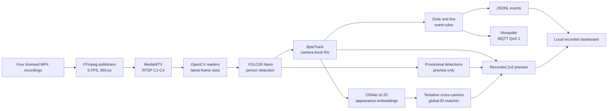

# Multi-Camera CCTV Analytics Project

**CPU-optimised, four-camera video analytics with person detection, tracking, experimental cross-camera association, event rules, and MQTT.**


A reproducible computer-vision engineering project built for **Windows + Python**, with local RTSP streams replayed from recorded videos. It combines YOLO26 Nano, ByteTrack, OSNet appearance embeddings, a lightweight global-ID matcher, zone/line event processing, and a recorded four-camera dashboard. The project also includes controlled evaluation scripts, CPU performance experiments, and reproducible benchmark reports.

> **Project status:** Research/engineering prototype — **not** a production surveillance system or verified person-identification system. Cross-camera IDs are tentative. The browser dashboard replays a **recorded** inference run; it is not a live stream. The 20-FPS aggregate processing goal was **not** consistently achieved.

## Contents

- [What it does](#what-it-does)
- [System architecture](#system-architecture)
- [Technology stack](#technology-stack)
- [Measured results](#measured-results)
- [Prerequisites](#prerequisites)
- [Datasets and video downloads](#datasets-and-video-downloads)
- [Model downloads](#model-downloads)
- [Windows installation](#windows-installation)
- [Run the four-camera pipeline](#run-the-four-camera-pipeline)
- [Build and view the recorded dashboard](#build-and-view-the-recorded-dashboard)
- [Reproduce experiments](#reproduce-experiments)
- [Before-and-after showcase](#before-and-after-showcase)
- [Repository structure](#repository-structure)
- [Troubleshooting](#troubleshooting)
- [Limitations and responsible use](#limitations-and-responsible-use)
- [References and acknowledgements](#references-and-acknowledgements)

## What it does

1. **Replay four camera recordings:** FFmpeg publishes four looping MP4 sources at a nominal **5 FPS per camera** and **960-pixel width** to a local MediaMTX RTSP server.
2. **Process RTSP streams:** OpenCV reader threads use one-slot, latest-frame buffers to avoid unlimited queue growth. When inference falls behind, older decoded frames can be overwritten; the system measures these overwrites.
3. **Detect pedestrians:** YOLO26 Nano runs person-class inference at **640-pixel inference resolution**.
4. **Track within each camera:** ByteTrack maintains camera-local track IDs. Confirmed local tracks are separate from provisional detections used for visualisation only.
5. **Experiment with cross-camera association:** OSNet x0.25 encodes person crops; a camera-local-track-to-global-ID matcher uses appearance similarities. The **live** version uses an EMA prototype with cosine threshold **0.85** and margin **0.05**. Offline camera-balanced/Hungarian and source-consistency alternatives are research experiments, **not deployed changes**.
6. **Generate events:** Confirmed local tracks feed illustrative zone-entry, zone-exit, and line-crossing rules, producing JSONL logs and **MQTT QoS 1** messages.
7. **Export a recorded dashboard:** A 2×2 camera mosaic, searchable event timeline, and measured performance/delivery metrics can be viewed locally in a browser.

### Design decisions

- **CPU-first:** Small detector and appearance encoder, cross-camera ReID crop batching, cached embeddings, and controllable PyTorch threads/CPU affinity.
- **Latest-frame policy:** Prefer bounded memory and reduced stale-frame backlog over processing every decoded frame; drops are measured rather than hidden.
- **Conservative event semantics:** Provisional detections do **not** trigger ReID or events, and tentative global-ID associations are not treated as verified identities.
- **Evidence-oriented iteration:** Separate detection/tracking evaluation, oracle-track ReID experiments, retrieval benchmarks, and live RTSP/MQTT tests. Improvements observed offline are not automatically presented as deployed improvements.

## System architecture



**Important distinctions:** Local ByteTrack IDs are tracking hypotheses within a camera. Global IDs are cross-camera appearance hypotheses, **not biometric identification**. Zones and lines are illustrative until calibrated for a specific scene.

## Technology stack

| Layer | Technology |
|---|---|
| Language / development | Python 3.11, Windows, VS Code |
| Detector | [Ultralytics YOLO26n](https://docs.ultralytics.com/models/yolo26/) |
| Local tracker | ByteTrack |
| ReID embeddings | [BoxMOT](https://github.com/mikel-brostrom/boxmot) OSNet x0.25 MSMT17, PyTorch FP32/CPU |
| Association | Production EMA/cosine matcher; offline camera-balanced/Hungarian alternatives |
| Video ingestion | FFmpeg, RTSP, [MediaMTX](https://github.com/bluenviron/mediamtx), OpenCV |
| Events / messaging | Python zone/line rules, JSONL, [Eclipse Mosquitto](https://mosquitto.org/), MQTT QoS 1 |
| Services | Docker Desktop + Docker Compose (local-only exposed ports) |
| Evaluation | WILDTRACK, Market-1501, NumPy/SciPy, custom per-frame pair metrics |
| Presentation | Static HTML dashboard served on localhost; H.264 MP4 playback |

## Measured results

All values below were measured in the project experiments; they are **not** vendor-model benchmark claims.

### A. Four-camera live RTSP reliability

Three **180-second** tests used four nominal 5-FPS published streams, YOLO/ByteTrack, the production OSNet x0.25 matcher, event rules, and an independent MQTT subscriber.

| Metric | Trial 1 | Trial 2 | Trial 3 |
|---|---:|---:|---:|
| Aggregate processed FPS | 15.196 | 16.683 | 16.839 |
| Worst complete 10-second throughput | 13.6 FPS | 15.2 FPS | 12.8 FPS |
| 10-second windows below 20 FPS | 18/18 | 18/18 | 18/18 |
| Application-buffer overwrites | 1,047 | 779 | 751 |
| P95 four-camera batch processing | 343.12 ms | 311.45 ms | 335.37 ms |
| Peak inference process-tree RSS | 840.92 MiB | 820.36 MiB | 818.61 MiB |
| Independently received MQTT events | 354/354 | 351/351 | 222/222 |

**Conclusion:** All runs completed and **927/927 generated events were received** by the local independent subscriber, with no observed missing/duplicate event IDs. The strict 20-FPS target **failed in every run**, and **2,577 application-buffer overwrites** occurred. MQTT QoS 1 is **at-least-once**, not an exactly-once guarantee; transport delivery does not establish event correctness.

### B. Cross-camera identity matching (offline, WILDTRACK)

The later evaluation used **60 previously unused annotated WILDTRACK frame sets**, with **ground-truth boxes and perfect camera-local tracks** to isolate the association stage. All variants used the same input features.

| Association method | Correct GT cross-camera pair observations | Observed false pairs | Pair recall | Distinct correctly linked people |
|---|---:|---:|---:|---:|
| **Production:** EMA / threshold 0.85 | 29 / 3,694 | 0 | **0.79%** | 3 |
| **Experimental only:** Camera-balanced + Hungarian / threshold 0.80 | 167 / 3,694 | 0 | **4.52%** | 11 |
| Experimental + source-history consistency | 167 / 3,694 | 0 | **4.52%** | 11 |

The experimental method recovered **5.8× as many correct pair observations** as the production policy on that clip, but still missed **3,527** of **3,694** ground-truth opportunities. These are **per-frame pair metrics**, not official IDF1/HOTA or end-to-end live identity accuracy. The experiments share a site/cameras; zero observed false pairs is **not** a general precision guarantee. **The experimental matcher was not deployed in RTSP.**

### C. CPU ReID encoder comparison (Market-1501 sampled pilot)

| Metric | OSNet x0.25 | OSNet x1.0 |
|---|---:|---:|
| Sampled Rank-1 | **54.00%** | 47.33% |
| Sampled mAP | **36.33%** | 31.10% |
| Measured CPU encoding latency per crop | **5.92 ms** | 65.85 ms |

This used a **150-query pilot and reduced gallery**, **not the official full-gallery benchmark**. The larger model was approximately 11.1× slower in this setup and did not improve retrieval. OSNet x0.25 was retained. For detailed protocols and evidence, see [`docs/RESULTS.md`](docs/RESULTS.md) and [`docs/EVALUATION.md`](docs/EVALUATION.md).

## Prerequisites

- **Windows 10/11**, Python **3.11** recommended, and a working `python`/`py` command.
- **FFmpeg + ffprobe** on `PATH`, with `libx264` enabled, for RTSP publishing and browser-compatible demo conversion.
- **Docker Desktop** with Docker Compose for local MediaMTX and Mosquitto.
- **CPU:** CPU-only inference works; four PyTorch threads were used in the reported runs. A multi-core CPU is recommended. GPU is **not required**.
- Internet connection for initial dependencies, checkpoints, and optional datasets.
- Sufficient disk space for four MP4 recordings, evaluation PNGs, model weights, and local recordings.
- Rights to use and, separately, **publish** any recorded video or dataset imagery.

Confirm tool availability in **Command Prompt (`cmd.exe`)**:

```bat
py --version
git --version
ffmpeg -version
ffprobe -version
ffmpeg -encoders | findstr libx264
docker compose version
```

> The commands below use Windows **Command Prompt** syntax. If using PowerShell, activate with `.venv\Scripts\Activate.ps1` instead of `activate`.

## Datasets and video downloads

### 1. WILDTRACK camera videos — required for the four-camera demo

The project uses four views from the EPFL CVLAB **WILDTRACK** dataset. The original dataset contains seven partially overlapping, synchronised camera views, but this implementation uses **C1–C4 only**.

**Official source:** [EPFL CVLAB — WILDTRACK dataset and videos](https://www.epfl.ch/labs/cvlab/data/data-wildtrack/)

Download **Camera 1–4 videos** from the links published on that page:

| Project input | Official video link | Save/convert locally as |
|---|---|---|
| C1 | [Camera 1 (Google Drive)](https://drive.google.com/open?id=1sGUnExmJM2_tFuBd9LNlexf0LN2m0_c-) | `data/wildtrack/cam1.mp4` |
| C2 | [Camera 2 (Google Drive)](https://drive.google.com/open?id=1OnaRN2qYhZ2n4rSaNZQJzQPd1Cl2fluk) | `data/wildtrack/cam2.mp4` |
| C3 | [Camera 3 (Google Drive)](https://drive.google.com/open?id=1I7ARLVVfZqdZTbYG_TPEfDt1Bc8N35Lb) | `data/wildtrack/cam3.mp4` |
| C4 | [Camera 4 (Google Drive)](https://drive.google.com/open?id=1sXn70X-bV_YGPv43r4-iMtK_Js09eUVB) | `data/wildtrack/cam4.mp4` |

Expected video layout:

```text
data/
└── wildtrack/
    ├── cam1.mp4
    ├── cam2.mp4
    ├── cam3.mp4
    └── cam4.mp4
```

If a download has a different container/extension, convert it to an MP4 using FFmpeg and then use the required filename, for example:

```bat
ffmpeg -i "PATH_TO_CAMERA1_SOURCE_VIDEO" -c:v libx264 -preset veryfast -crf 20 -pix_fmt yuv420p -an "data\wildtrack\cam1.mp4"
```

Repeat for cameras 2–4. Verify that the recordings play and that you have mapped the **correct camera view** to each filename. The publisher loops the recordings and samples to 5 FPS. Frame-time alignment in the live RTSP pipeline is approximate and should **not** be assumed to match annotation-frame synchronisation.

### 2. WILDTRACK labelled frames — optional, for offline accuracy experiments

Use the **annotated frames**, not the raw MP4 files, for evaluation against person ground truth.

- [Official WILDTRACK dataset page](https://www.epfl.ch/labs/cvlab/data/data-wildtrack/) — select `Wildtrack_dataset_full.zip` for frames, calibration and annotations.
- The repository's `src.evaluate` downloader can retrieve a **subset of annotated frames** into `data/wildtrack_eval/` from the mirror configured in `src/evaluate.py`.

After installation:

```bat
python -m src.evaluate download --frames 20
python -m src.identity_evaluation audit --frames 20
```

Expected labelled structure (when extracted or downloaded):

```text
data/wildtrack_eval/
├── Image_subsets/
│   ├── C1/00000000.png
│   ├── C2/00000000.png
│   ├── C3/00000000.png
│   └── C4/00000000.png
└── annotations_positions/
    └── 00000000.json
```

The advanced Step 14.27 late-clip replay additionally needs cached **earlier** oracle/features/Step 14.25 artifacts. It is **not a standalone test from a fresh clone**, and is unnecessary for the RTSP demo.

### 3. Market-1501 — optional, for ReID retrieval benchmarking

Download [Market-1501](https://drive.google.com/file/d/0B8-rUzbwVRk0c054eEozWG9COHM/view?usp=sharing) and extract it according to the [deep-person-reid dataset instructions](https://github.com/KaiyangZhou/deep-person-reid/blob/master/docs/datasets.rst). Dataset access and download links may change; consult the dataset author's terms. The original dataset documentation specifies **research-only use**.

```text
data/market1501/
└── Market-1501-v15.09.15/
    ├── query/
    ├── bounding_box_test/
    └── bounding_box_train/        (not required for the benchmark script)
```

The benchmark uses `query/` and `bounding_box_test/`. It does not require retraining.

## Model downloads

**Model files are not included in GitHub.** Place them in the local `models/` directory. The models and dataset have separate authors, licenses, and redistribution terms.

| Model | Required? | Download/reference | Filename |
|---|---|---|---|
| **YOLO26 Nano** (person detector) | **Yes** | [Ultralytics YOLO26 documentation](https://docs.ultralytics.com/models/yolo26/) | `models/yolo26n.pt` |
| **OSNet x0.25 MSMT17** (production ReID) | **Yes** | [Hugging Face checkpoint](https://huggingface.co/spaces/xfys/yolov5_tracking/blob/main/weights/osnet_x0_25_msmt17.pt) | `models/osnet_x0_25_msmt17.pt` |
| OSNet x1.0 MSMT17 (comparison only) | No | See [BoxMOT ReID model documentation](https://mikel-brostrom.github.io/boxmot/) or the original Step 14.26 checkpoint source | `models/osnet_x1_0_msmt17.pt` |

Create the directory:

```bat
mkdir models
```

**YOLO26n:** Ultralytics downloads official weights on first load. From the project root, run:

```bat
python -c "from ultralytics import YOLO; YOLO('yolo26n.pt')"
move yolo26n.pt models\yolo26n.pt
```

If the file already exists locally, keep the existing file. The detector expects the model at `models/yolo26n.pt`.

**OSNet x0.25:** Download it manually, or allow `src/reid.py` to download the specified checkpoint on first use. A manual Windows `cmd.exe` download is:

```bat
curl.exe -L --fail "https://huggingface.co/spaces/xfys/yolov5_tracking/resolve/main/weights/osnet_x0_25_msmt17.pt" -o "models\osnet_x0_25_msmt17.pt"
certutil -hashfile "models\osnet_x0_25_msmt17.pt" SHA256
```

Required OSNet SHA-256 (the source checks it):

```text
cf55163d78fc44c62c82f85ab62d39f10438679b5abe8c698ae08cfa84aa6e18
```

The x1.0 checkpoint is **optional**; do not download or rename an unrelated `.pth` checkpoint merely to make the filename match. Use the exact compatible weight file expected by BoxMOT.

## Windows installation

From your cloned or staged **public** repository:

```bat
git clone https://github.com/nanthawe/multicam-analytics.git
cd multicam-analytics
py -3.11 -m venv .venv
.venv\Scripts\activate
python -m pip install --upgrade pip
python -m pip install -r requirements.txt
```

If the repository is already present on disk, skip `git clone` and start from `cd`. `requirements.txt` includes Ultralytics, `boxmot==25.0.0`, OpenCV, MQTT, psutil and analysis dependencies; PyTorch is installed through the compatible package dependencies. If your Python/PyTorch combination is unsupported, install an appropriate CPU-compatible PyTorch build before rerunning requirements.

Check that the source passes its tests:

```bat
python -m unittest discover -s tests -p "test_*.py" -q
python scripts\preflight_release.py
```

The test suite uses synthetic fixtures/mocks for many external integrations. Passing does **not** prove that the models, RTSP feeds or Docker services are installed correctly.

## Run the four-camera pipeline

Keep **three terminals** open and run all commands from the project root with the virtual environment activated where Python is used.

### Terminal 1 — Start local RTSP and MQTT services

```bat
docker compose -f compose.rtsp.yaml up -d
docker compose up -d
docker compose -f compose.rtsp.yaml ps
docker compose ps
```

Services use localhost ports:

- MediaMTX: `rtsp://127.0.0.1:8554/C1`, `/C2`, `/C3`, `/C4`
- Mosquitto MQTT broker: `127.0.0.1:1883`

The sample broker permits anonymous connections and is bound to loopback for **local experimentation only**. Do not expose it to a public network.

### Terminal 2 — Start the four FFmpeg RTSP publishers

```bat
python -m src.publish_rtsp --width 960 --fps 5
```

Leave this terminal running. It reads `data/wildtrack/cam1.mp4` through `cam4.mp4` and publishes all four views. Press **Ctrl+C** to stop the publishers.

### Terminal 3 — Preflight and short reliability smoke test

```bat
python -m src.reliability_validation preflight
python -m src.reliability_validation run --seconds 30 --repeats 1 --threads 4 --affinity all --root outputs/rtsp/smoke_01
python -m src.reliability_validation compare --root outputs/rtsp/smoke_01
```

The preflight checks all four RTSP streams and MQTT subscription connectivity. The smoke run saves logs, a preview, event/transport reports and resource samples under the specified `outputs/rtsp/` directory. **Use a new directory for each run:** the runner protects existing manifests from accidental overwrites.

The original CPU setup used `--threads 4 --affinity 0,2,4,6,8,10`. Those logical CPU IDs are machine-specific. **Start with `--affinity all`** unless you have verified your processor layout and the process affinity mask.

A **30-second** smoke run may generate zero zone/line events, so MQTT delivery may be reported as **inconclusive**, not PASS. This does not necessarily indicate a broken pipeline.

### Optional — Direct interactive inference command

For a shorter direct pipeline test outside the multi-trial reliability wrapper:

```bat
python -m src.live_rtsp --seconds 60 --warmup-batches 5 --threads 4 --mqtt --provisional-preview
```

This uses the existing production matcher and event rules. It writes local artifacts rather than opening a real-time browser dashboard.

### Full three-run reliability experiment

After the smoke test succeeds and all four streams are stable:

```bat
python -m src.reliability_validation run --seconds 180 --repeats 3 --threads 4 --affinity all --root outputs/rtsp/release_180s
python -m src.reliability_validation compare --root outputs/rtsp/release_180s
```

The target is **20 aggregate processed FPS**, but the previously observed runs achieved **15.196–16.839 FPS**. Expect results to vary with CPU, codec settings, host load and source footage. Report both throughput and application-buffer overwrites.

Stop local services when finished:

```bat
docker compose -f compose.rtsp.yaml down
docker compose down
```

## Build and view the recorded dashboard

The dashboard is generated **from a completed benchmark recording**, not from live RTSP.

Requirements for the selected trial:

- The trial was completed successfully.
- Its independent MQTT subscriber verdict is **PASS**.
- It contains `report.json`, `per_batch.csv`, `events.jsonl`, `validation.json` and `provisional_preview.mp4`.
- FFmpeg supports H.264 encoding via `libx264`.

**Use your newly generated run** (replace `release_180s` with the actual root and select one `overlay_mqtt_XX` trial):

```bat
python -m src.demo_release build --source outputs/rtsp/release_180s --trial overlay_mqtt_02 --output outputs/demo/github_demo
python -m src.demo_release serve --output outputs/demo/github_demo --port 8765
```

Then open **http://127.0.0.1:8765/** in a browser.

The dashboard exporter creates:

```text
outputs/demo/github_demo/
├── index.html
├── preview_h264.mp4
├── data.json
└── evidence_manifest.json
```

Use the dashboard to **view the four-camera mosaic**, **search/filter the event timeline**, **jump from an event to the corresponding rendered video frame**, and **inspect measured performance and MQTT-delivery results**. Video playback timestamps represent encoded-frame positions, **not wall-clock camera capture timestamps**.

## Reproduce experiments

These evaluations are **separate from the live dashboard** and are optional when demonstrating the system to recruiters.

### A. Labelled WILDTRACK detection/tracking evaluation

```bat
python -m src.evaluate download --frames 20
python -m src.evaluate run --frames 20
```

Uses annotated synchronised PNGs and reports detection/tracking diagnostics; results depend on the sampled frames. Do **not** present these as official TrackEval HOTA/IDF1 scores.

### B. Market-1501 CPU retrieval pilot

Requires `data/market1501/Market-1501-v15.09.15/` and **both** OSNet x0.25 and x1.0 compatible checkpoints:

```bat
python -m src.encoder_benchmark prepare --mode pilot --max-queries 150 --gallery-per-pid-camera 2
python -m src.encoder_benchmark run --threads 4 --affinity all --batch-size 16
python -m src.encoder_benchmark report
```

To use the **full query/gallery set**, prepare a **new output directory** with `--mode full` and use that directory for both `run` and `report`. Full-gallery results take longer and must be reported separately from the sampled pilot.

### C. Late-clip cross-camera policy comparison (advanced)

```bat
python -m src.identity_validation prepare --download
python -m src.identity_validation extract --threads 4 --affinity all
python -m src.identity_validation run
python -m src.identity_validation report
```

**Not runnable from a fresh clone without prerequisites:** this stage requires the early-frame oracle manifest, original annotations, cached earlier OSNet features and Step 14.25 source-consistency report, plus the matching pretrained checkpoint hash. Consult [`docs/EVALUATION.md`](docs/EVALUATION.md) and the module's docstring. It uses oracle camera-local tracks and is an **offline association diagnostic**, not a live person-ID score.

**Experiment index:** [`docs/EXPERIMENT_INDEX.md`](docs/EXPERIMENT_INDEX.md) · **Curated results:** [`docs/evidence/curated/`](docs/evidence/curated/)

## Repository structure

```text
multicam-analytics/
├── src/
│   ├── detector.py                 # YOLO26n person detection
│   ├── tracker.py                  # Camera-local ByteTrack
│   ├── reid.py                     # OSNet encoder + production association
│   ├── framesource.py              # Local video paths
│   ├── publish_rtsp.py             # Four FFmpeg RTSP publishers
│   ├── live_rtsp.py                # Four-stream processing
│   ├── events.py                   # Zone and line rules
│   ├── mqtt_events.py              # MQTT publishing
│   ├── reliability_validation.py   # Repeated full-system measurements
│   ├── demo_release.py             # Recorded dashboard exporter/server
│   ├── demo_assets/               # Browser dashboard HTML
│   ├── encoder_benchmark.py        # Market-1501 model comparison
│   └── identity_validation.py      # Offline policy validation
├── tests/                          # Synthetic/regression tests
├── scripts/                        # Cleanup, release preflight, video comparison
├── docs/                           # Results, evaluation, demo, architecture, limits
│   └── evidence/curated/           # Aggregate-only benchmark evidence
├── config/mosquitto.conf
├── compose.rtsp.yaml               # MediaMTX service
├── compose.yaml                    # Mosquitto service
├── data/                           # Local datasets/videos; ignored by Git
├── models/                         # Local pretrained weights; ignored by Git
├── outputs/                        # Local reports/recordings; ignored by Git
├── requirements.txt
└── README.md
```

## Troubleshooting

| Symptom | Check / fix |
|---|---|
| `Missing camera recording` | Check `data/wildtrack/cam1.mp4` through `cam4.mp4` exactly, including extensions. |
| RTSP preflight fails on C1–C4 | Start both Docker services, then the publisher terminal; inspect `outputs/rtsp/publishers/C1.log` through `C4.log`. Avoid duplicate publishers. |
| `FFmpeg not found` or H.264 conversion fails | Ensure `ffmpeg` and `ffprobe` are on PATH; check `ffmpeg -encoders | findstr libx264`. |
| Missing `models/osnet_x0_25_msmt17.pt` | Download the linked checkpoint or allow the artifact resolver to fetch it; verify the exact SHA-256. |
| Missing `models/yolo26n.pt` | Load/download `yolo26n.pt` with Ultralytics and move it to the `models/` folder. |
| Missing `osnet_x1_0_msmt17.pt` in encoder benchmark | It is **optional for live inference**, but required if comparing both encoders. Confirm the exact `.pt` filename and model architecture. |
| MQTT status is `INCONCLUSIVE` | A short run may generate no events; use a longer run on footage that crosses the configured illustrative rules. Do not relabel inconclusive delivery as PASS. |
| Demo exporter rejects trial | Confirm completed trial, subscriber verdict PASS, all required video/CSV/JSONL reports, and a new destination folder. |
| Throughput below 20 FPS | Expected on the tested configuration; profile CPU/FFmpeg contention, batch latency and application-buffer overwrites instead of assuming a model failure. |
| Replay validation fails after clean clone | The late-clip experiment requires earlier oracle/feature/Step 14.25 caches; see its prerequisite section. |

## Limitations and responsible use

- **Not production-ready.** The system is a local computer-vision prototype, without a security/privacy review, field deployment, identity verification, calibrated event areas, or failover guarantees.
- **Cross-camera identity recall is low.** Even the strongest undeployed policy achieved only **4.52%** pair recall on the later oracle-track WILDTRACK segment. Global IDs should not be used for consequential decisions about people.
- **Tracking evaluation and live streaming are different tests.** The offline association study uses ground-truth boxes and perfect within-camera tracks; real YOLO/ByteTrack errors were excluded.
- **20 aggregate FPS was not sustained.** The measured trial results are reported above; buffering deliberately overwrites decoded frames when processing falls behind.
- **MQTT delivery is not event accuracy.** 927/927 events received is a local transport observation. QoS 1 does not promise exactly-once semantics; no manually annotated event-correctness benchmark was run.
- **Latency scope is limited.** Reported frame age begins on Python decode receipt, not physical camera exposure. Recorded dashboard video timestamps are playback positions.
- **No redistribution of private/third-party media.** `data/`, `models/`, and `outputs/` are ignored by Git. Review dataset and pretrained-weight terms independently, and obtain permission before uploading clips or screenshots containing identifiable pedestrians. Market-1501 documentation restricts use to research.
- **Code licensing is undecided.** Add a deliberate `LICENSE` after checking dependency and data/model terms; do not assume that publicly visible code or pretrained weights are unrestricted for reuse.

See [`docs/LIMITATIONS.md`](docs/LIMITATIONS.md), [`docs/PUBLISH.md`](docs/PUBLISH.md), and [`docs/PROJECT_CLEANUP.md`](docs/PROJECT_CLEANUP.md).

## References and acknowledgements

- [WILDTRACK Seven-Camera HD Dataset — EPFL CVLAB](https://www.epfl.ch/labs/cvlab/data/data-wildtrack/). Chavdarova et al., *WILDTRACK: A Multi-camera HD Dataset for Dense Unscripted Pedestrian Detection*, CVPR 2018.
- [Market-1501 — dataset setup and original download reference](https://github.com/KaiyangZhou/deep-person-reid/blob/master/docs/datasets.rst). Zheng et al., *Scalable Person Re-identification: A Benchmark*, ICCV 2015.
- [Ultralytics YOLO26](https://docs.ultralytics.com/models/yolo26/).
- [BoxMOT person tracking and ReID tooling](https://github.com/mikel-brostrom/boxmot).
- [OSNet x0.25 MSMT17 weight artifact](https://huggingface.co/spaces/xfys/yolov5_tracking/blob/main/weights/osnet_x0_25_msmt17.pt).
- [MediaMTX](https://github.com/bluenviron/mediamtx), [FFmpeg](https://ffmpeg.org/), [Eclipse Mosquitto](https://mosquitto.org/).

---

**Scope:** A reproducible, CPU-based *multi-camera video analytics engineering prototype*, with documented experiments, measured limitations, and a recorded demo workflow. Experimental improvements are explicitly distinguished from the deployed streaming configuration.
